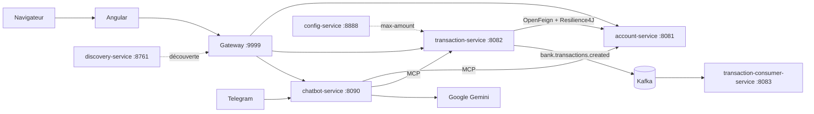

# Plateforme bancaire micro-services

Plateforme de consultation de comptes et d'enregistrement de transactions, avec un assistant IA accessible depuis le web et Telegram, des événements Kafka et un volet de détection de fraude en Python.

Réalisée par **Mustapha Elmifdali** pour l'épreuve technique ENSET / ADRIA 2027.

## Fonctionnalités

- Comptes bancaires : consultation, création, blocage et activation.
- Transactions et virements, avec plafond, devise, statut du compte et solde vérifiés.
- Trois connecteurs sur chaque service métier : REST, GraphQL et MCP, tous reliés à la même couche service.
- Tolérance aux pannes avec OpenFeign et Resilience4J : sans réponse du service des comptes, une transaction est refusée.
- Assistant IA (Spring AI et Gemini) qui agit à travers les outils MCP et demande une confirmation avant une opération.
- Événements Kafka publiés après la validation en base, puis journalisés par un service consumer.
- Client web Angular : comptes, transactions et assistant.
- Détection de fraude : pipeline scikit-learn et régression logistique.

## Architecture



| Module | Port | Rôle |
|---|---|---|
| `discovery-service` | 8761 | Annuaire Eureka |
| `config-service` | 8888 | Partage de `bank.transaction.max-amount=1000` |
| `gateway-service` | 9999 | Point d'entrée unique |
| `account-service` | 8081 | Comptes bancaires, base H2 |
| `transaction-service` | 8082 | Transactions et virements, base H2 |
| `transaction-consumer-service` | 8083 | Journalisation des événements Kafka |
| `chatbot-service` | 8090 | Agent IA, API REST et bot Telegram |
| `angular-front` | 4200 / 80 | Client web |
| `fraud-detection` | - | Script Python de détection de fraude |

Les services métier suivent les couches `domain`, `repository`, `service`, `web/rest`, `web/graphql` et `mcp`.

## Technologies

Java 21, Spring Boot 4.1, Spring Cloud 2025.1, Spring AI 2.0, Spring for Apache Kafka, Resilience4J, H2, Angular 22, Bootstrap 5, Python, scikit-learn, Docker et GitHub Actions.

## Prérequis

- JDK 21
- Node.js 22 ou plus
- Python 3.11 ou plus, pour la détection de fraude
- Docker, pour Kafka et le lancement complet
- Une clé API Gemini, et un token Telegram si vous utilisez le bot

Créez le fichier `.env` à la racine à partir de `.env.example`, puis renseignez vos valeurs. Ce fichier est ignoré par Git : ne le publiez jamais.

```bash
cp .env.example .env
```

## Lancement

### Avec Docker Compose

```bash
docker compose up --build
```

- Application : http://localhost
- Gateway : http://localhost:9999
- Eureka : http://localhost:8761

### En local

Démarrez Kafka :

```bash
docker compose up -d kafka
```

Compilez le projet :

```bash
./mvnw clean package
```

Lancez ensuite chaque service dans cet ordre, une seule fois chacun :

1. `discovery-service`
2. `config-service`
3. `account-service`
4. `transaction-service`
5. `transaction-consumer-service`
6. `gateway-service`
7. `chatbot-service`

Puis le client web, sur http://localhost:4200 :

```bash
cd angular-front
npm install
npm start
```

> Ne démarrez pas deux fois le même service. La deuxième copie échoue sur le port occupé et désinscrit la première d'Eureka pendant quelques secondes.

## Exemples d'utilisation

Toutes les URL passent par la gateway.

```bash
curl http://localhost:9999/ACCOUNT-SERVICE/accounts
```

Paiement :

```bash
curl -X POST http://localhost:9999/TRANSACTION-SERVICE/transactions -H "Content-Type: application/json" -d '{"accountId":"<id>","amount":250,"currency":"MAD","merchantCategory":"GROCERY","country":"MA"}'
```

Virement :

```bash
curl -X POST http://localhost:9999/TRANSACTION-SERVICE/transactions/transfer -H "Content-Type: application/json" -d '{"fromAccountId":"<id>","toAccountId":"<id>","amount":100,"currency":"MAD"}'
```

Assistant :

```bash
curl "http://localhost:9999/CHATBOT-SERVICE/chat?conversationId=demo&query=Liste%20les%20comptes"
```

| Interface | URL |
|---|---|
| GraphiQL comptes | http://localhost:8081/graphiql |
| GraphiQL transactions | http://localhost:8082/graphiql |
| MCP comptes | http://localhost:8081/mcp |
| MCP transactions | http://localhost:8082/mcp |
| État du disjoncteur | http://localhost:8082/actuator/circuitbreakers |

## Kafka

Après la validation d'une transaction, `transaction-service` publie un événement dans `bank.transactions.created`, avec `accountId` comme clé du message. Une transaction annulée ne publie rien.

```json
{
  "eventId": "UUID",
  "eventType": "TransactionCreated",
  "transactionId": "UUID",
  "accountId": "UUID",
  "amount": 250.00,
  "currency": "EUR",
  "occurredAt": "2026-01-15T10:30:00Z"
}
```

`transaction-consumer-service` journalise chaque événement et ne modifie aucune donnée bancaire.

## Détection de fraude

```bash
cd fraud-detection
pip install -r requirements.txt
python fraud_detection.py
```

Résultats sur le jeu de test, classe fraude :

| Mesure | Valeur |
|---|---|
| Précision | 0,208 |
| Rappel | 0,196 |
| F1-score | 0,202 |
| Average precision | 0,184 (hasard : 0,051) |

Le prétraitement et le seuil sont définis sur l'entraînement uniquement. Les résultats complets sont dans `fraud-detection/results/`.

## Tests

```bash
./mvnw test
```

Les tests unitaires couvrent les règles métier d'`account-service` et de `transaction-service`.

## CI/CD

Le pipeline `.github/workflows/ci-cd.yml` enchaîne la compilation, les tests, le build Angular, la construction des images, leur publication dans GitHub Container Registry et une étape de déploiement schématique.

## État du projet

Testé :

- Micro-services, gateway, Eureka et config-service
- Tolérance aux pannes en arrêtant `account-service`
- Assistant via REST
- Client Angular
- Script de détection de fraude

Non vérifié de bout en bout :

- Échange Kafka avec un broker réel
- Lancement complet avec Docker Compose
- Exécution du pipeline GitHub Actions
- Conversation réelle sur Telegram

Non réalisé :

- Keycloak (authentification et autorisations)

## Limites connues

- Pas d'authentification : ce projet est une démonstration locale.
- Les bases H2 sont en mémoire : les données repartent de zéro à chaque redémarrage.
- La confirmation de l'assistant est une règle du prompt, pas un contrôle côté serveur.
- Sans transaction distribuée, un débit qui expire après avoir été appliqué peut laisser un compte débité.
- Si Kafka est indisponible, la transaction reste enregistrée mais l'événement est perdu.
